# Recap - Buổi Nói Chuyện: AI & Tương Lai Ngành Kế Toán

**File:** `260321_120207.wav`
**Người nói chính:** Thi (AI Consultant / Trainer)
**Đối tượng:** Ngân (Kế toán viên)
**Chủ đề:** Tại sao Big Four đang bị disrupted bởi AI, và kế toán viên cần làm gì

---

## Tổng Quan

Buổi trò chuyện giữa Thi và Ngân về tác động của AI lên ngành kế toán, đặc biệt là các công ty Big Four. Thi trình bày các use case cụ thể của AI trong công việc kế toán hàng ngày, cách "sell" AI solution cho công ty, giới thiệu khóa học 4 buổi về AI cho kế toán viên, và demo trực tiếp Claude Code ngay trong buổi nói chuyện.

---

## 1. Big Four Là "Bad Idea" Trong Kỷ Nguyên AI

### Vấn đề cốt lõi

Trước 2022, Big Four có lợi thế cạnh tranh lớn nhờ:
- **Relationship** và existing client base
- **Technology độc quyền** (chỉ họ mới đủ tiền đầu tư)
- **Data scale** lớn

AI đã **disrupt** tất cả những lợi thế này. Những tool trước đây chỉ Big Four mới có khả năng đầu tư (vd: đọc invoice tự động) thì bây giờ **bất kỳ công ty nhỏ nào cũng làm được**.

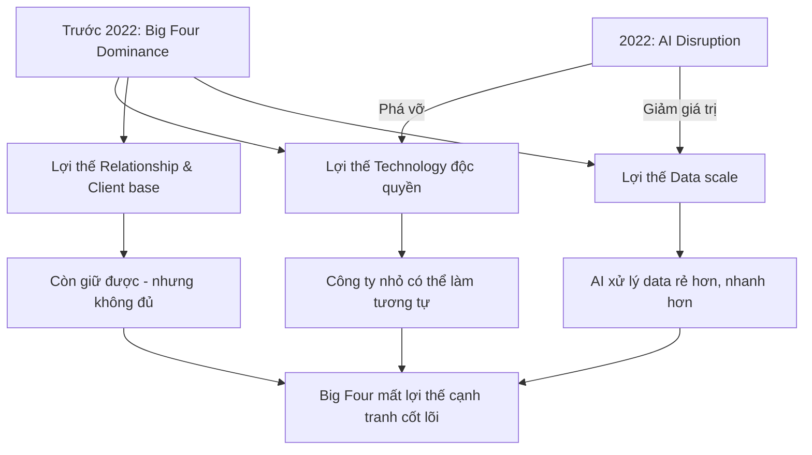

---

## 2. AI Use Cases Cụ Thể Trong Kế Toán

### 2.1 Xử Lý Invoice Tự Động

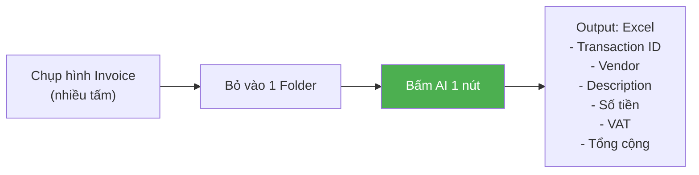

**So sánh thời gian:**

| Bước | Thủ công | Với AI |
|------|----------|--------|
| Nhập liệu | 1 tiếng | 20 phút |
| Kiểm tra lại | 30 phút | 1 tiếng (kiểm kỹ hơn) |
| **Tổng** | **1.5 tiếng** | **1 tiếng 20 phút** |
| **Tiết kiệm** | | **~30 phút / batch** |

> Đối với lo ngại "AI sai thì sao?" - Bản thân nhập tay cũng phải check lại. Với AI, dù check kỹ gấp đôi vẫn tiết kiệm thời gian.

### 2.2 Bank Statement Analysis

AI xử lý được cả những định dạng khó:
- PDF đẹp (select được chữ) - dễ
- PDF xấu (chụp hình, scan) - AI vẫn đọc được
- PNG bank statement - AI vẫn đọc được

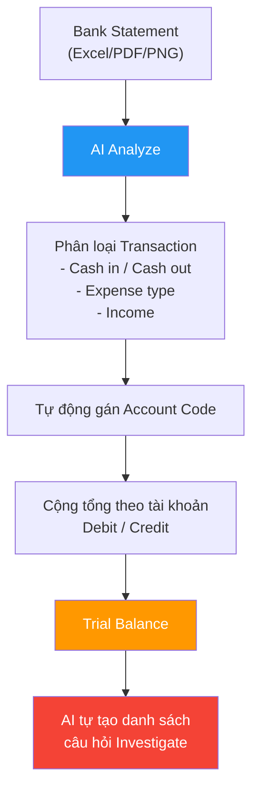

**Điểm đột phá:** AI bây giờ có khả năng **tự kiểm tra kết quả** (self-check loop) - làm xong, check, chỉnh, check lại cho đến khi balance match.

### 2.3 Demo Thực Tế: Từ Bank Statement Ra Trial Balance Trong 5 Phút

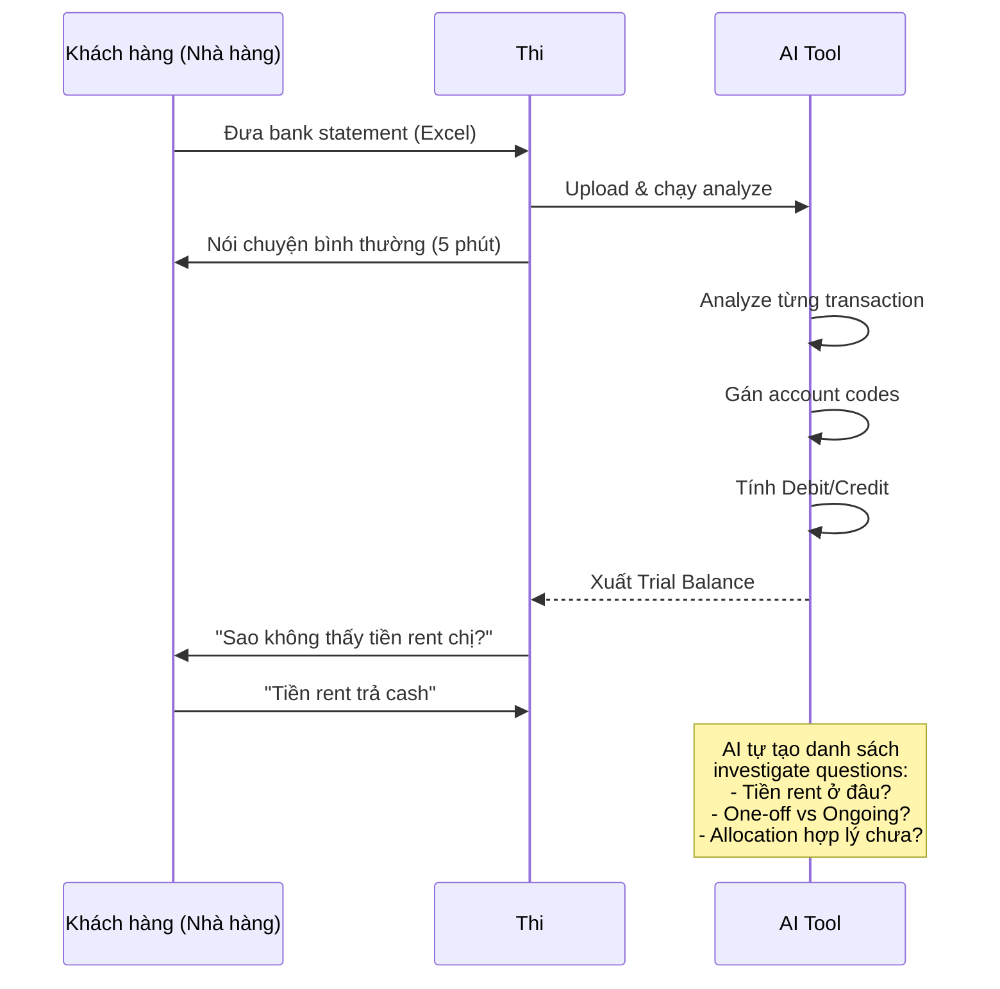

### 2.4 Statutory Filing & Import Phần Mềm

AI có thể xuất ra **file Excel chuẩn** để import vào phần mềm kế toán (vd: MGM). Chỉ cần nói với AI: *"Tao đang làm Statutory Filing. Mày làm."* -> AI xuất Excel đúng format để import.

> Tùy mục đích mỗi người. Kế toán hiểu bản chất thì nói AI làm đúng việc. Ngành khác thì cần học tư duy AI, hiểu ecosystem (Python, Claude Code) để tự áp dụng.

### 2.5 Payslip & Tư Vấn Cá Nhân Hóa Cho Từng Khách

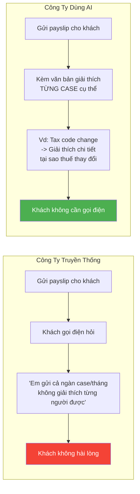

> **Ví dụ thực tế:** Đợt tax code change, khách hỏi rất nhiều. Với AI, mỗi payslip đều kèm giải thích cụ thể theo từng case, không phải chung chung. Khách chưa kịp hỏi thì mình đã gửi giải thích rồi. Công ty số 1 (manual) làm sao cạnh tranh được công ty số 2 (AI)?

---

## 3. Custom AI Rules - "Luật Chơi" Riêng Cho Mỗi Người

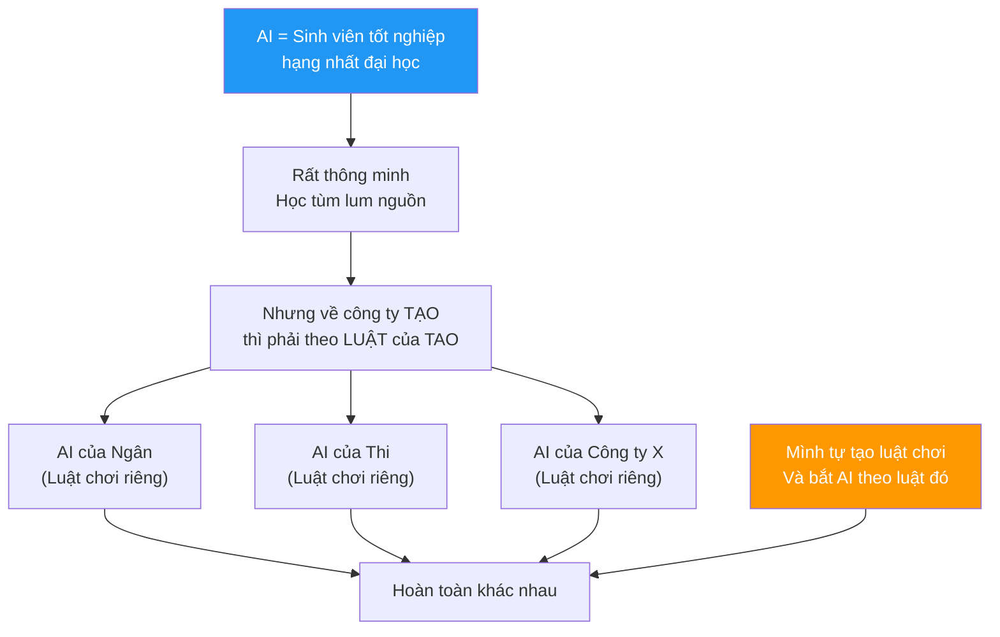

> AI giống như một đứa tốt nghiệp hạng nhất, rất thông minh, nhưng về công ty mình thì phải theo luật công ty mình. Mình set rule -> AI tuân theo -> Mỗi người có "con AI" riêng, chơi theo luật chơi hoàn toàn khác.

---

## 4. AI Trong Thực Tế Công Ty - Thách Thức & Cách Vượt Qua

### Mức độ Resistance theo loại công ty

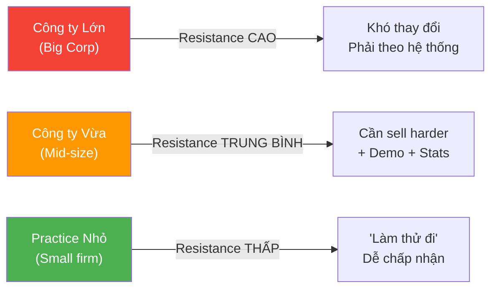

### Quy Trình "Sell" AI Solution Vào Công Ty (Kinh Nghiệm Của Thi)

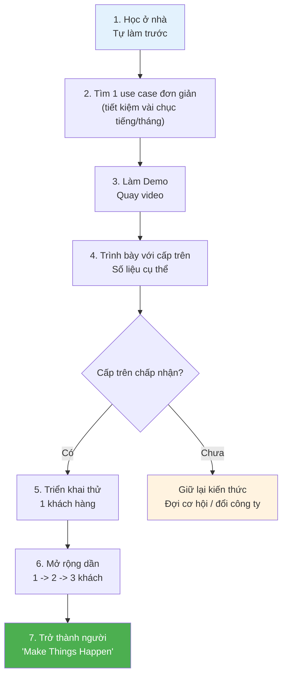

> **Kinh nghiệm Thi:** Bắt đầu là intern ở công ty nhỏ, ngành truyền thống (buôn bán đồ cổ). Từ ngày thứ 2-3 đã đề xuất cải tiến. Bị xem là "điên" nhưng làm demo, quay video gửi lại -> được thử -> dần dần mở rộng -> bây giờ khách hàng nghe theo và đang là khách hàng mua phần mềm.

---

## 5. Khóa Học AI Cho Kế Toán Viên (4 Buổi)

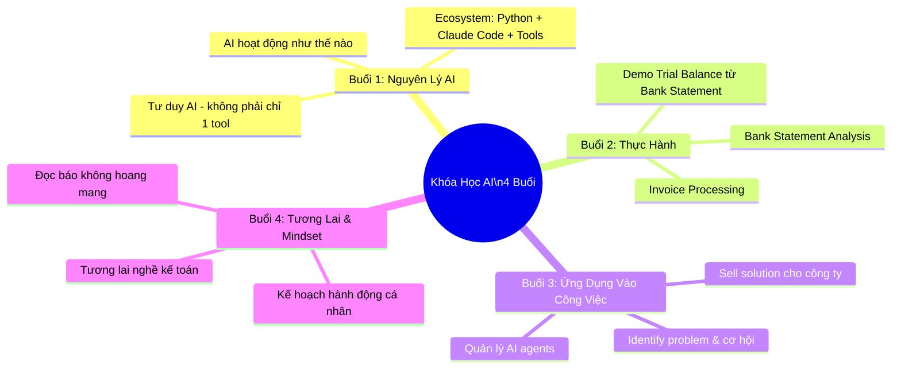

### Triết Lý Giảng Dạy

- **Học nguyên lý, không học tool cụ thể** - giống như học kế toán xong xài được bất kỳ phần mềm nào (Xero, QuickBooks... 1 tuần là quen)
- **Claude Code chỉ là phần mềm** - không cần sợ giao diện, biết bản chất rồi thì tool nào cũng xài được
- **Không cần học Prompt Engineering** - chỉ cần nói chuyện bình thường
- **Lớp nhỏ** - để trao đổi, thảo luận, tâm sự về công việc cụ thể (sáng vô làm gì, cái nào tự động hóa được)
- **On retainer** - Thi đồng hành lâu dài, không chỉ dạy xong bỏ
- **Mục tiêu:** Học xong = **hết hoang mang** khi đọc tin AI + biết mình sẽ ra sao 5-10 năm nữa

---

## 6. Các Cấp Độ Sử Dụng AI (Level 1-4)

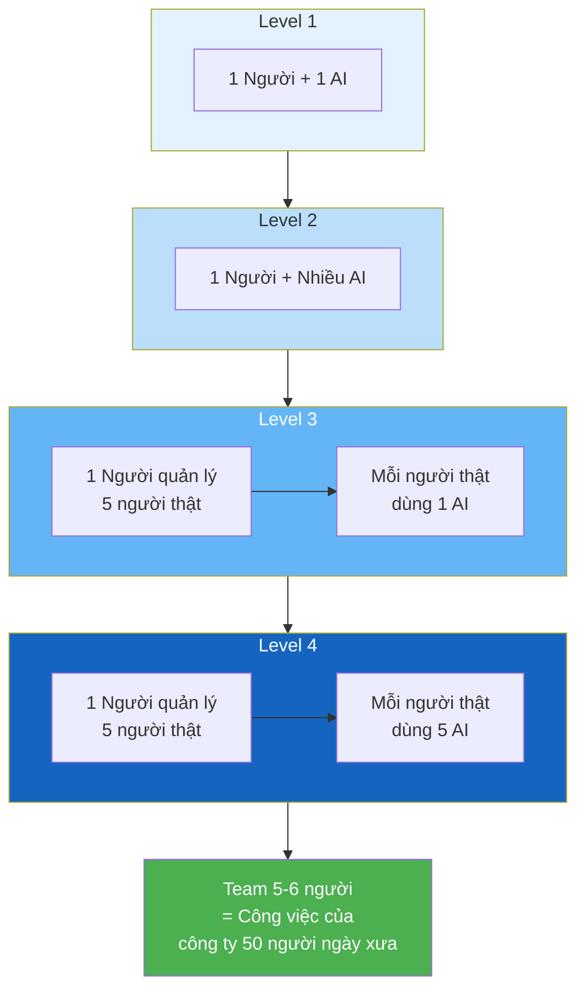

> **Kết quả thực tế:** Đội 12-20 người có thể **cạnh tranh với tập đoàn quốc tế**. Không ngại, thực sự là như vậy.

---

## 7. Công Ty Kế Toán Nhỏ Sẽ Biến Mất Nếu Làm Manual

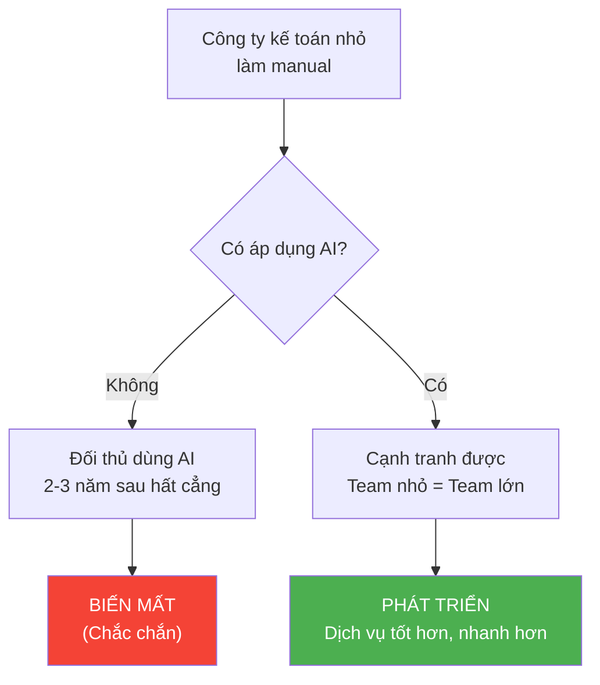

> Những công ty kế toán nhỏ mà cứ làm manual thì **chắc chắn sẽ biến mất**. Đối thủ dùng AI 2-3 năm sau sẽ hất cẳng.

---

## 8. Mindset Shift: "Everyone Just Got Promoted"

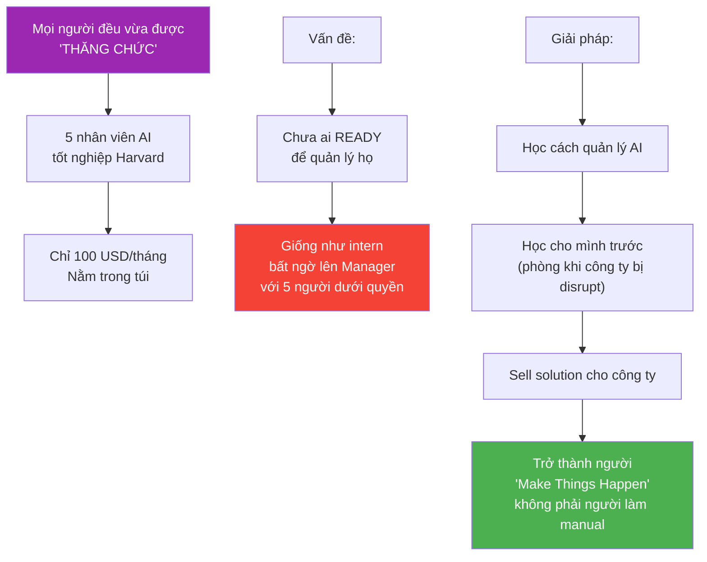

### Trích Dẫn Đáng Nhớ (Daniel Priestley)

> *"This is the most incredible time we're living in"*
> -- Mọi người đều có 1 đội AI 5 người tốt nghiệp Harvard, tất cả kỹ năng, chỉ 100 USD/tháng, nằm trong túi.

---

## 9. Cảnh Báo Về Truyền Thông & Tin Giả

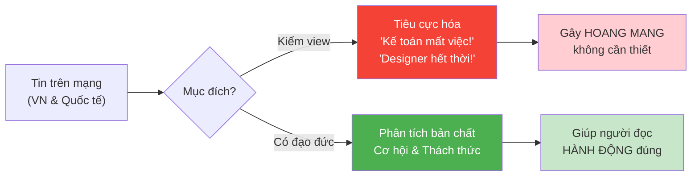

> Ngày xưa nhà báo có đạo đức nghề nghiệp. Bây giờ social media không còn đạo đức -> đăng nội dung tiêu cực để kiếm view. Học AI đúng cách = đọc báo **không còn hoang mang**, nhìn ra bản chất vấn đề ngay.

---

## 10. Demo Trực Tiếp: Claude Code Recap Cuộc Trò Chuyện

Thi demo ngay trong buổi nói chuyện bằng Claude Code:
- Ghi âm cuộc trò chuyện -> Transcribe -> Bỏ vào Claude Code
- Nói: *"Do me an MD with Mermaid detail recap please"*
- Claude Code tạo recap markdown có Mermaid diagrams
- Không cần học Prompt Engineering, chỉ nói chuyện bình thường

> **"Chỉ riêng cái việc mà nó có thể recap cuộc trò chuyện như thế này thôi là nó đã rất kinh khủng rồi. Chứ đừng nói tới những use case khác. Bây giờ một cái tool để Summarize Meeting rất là đắt rồi."**

> Mọi người thấy giao diện thì sợ. **Không có gì phải sợ hết.** Chuyện bình thường hết trơn.

---

## Tổng Kết Các Điểm Chính

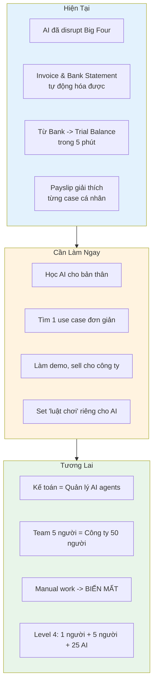

| # | Key Takeaway |
|---|-------------|
| 1 | Big Four mất lợi thế vì AI democratize technology |
| 2 | Invoice processing: từ 1.5h xuống 1h20 (và sẽ nhanh hơn nữa) |
| 3 | Bank statement -> Trial Balance trong 5 phút với AI |
| 4 | AI bây giờ có self-check loop - tự kiểm tra kết quả |
| 5 | AI xuất Excel chuẩn để import vào phần mềm kế toán (Statutory Filing) |
| 6 | Mỗi người tạo "luật chơi" riêng cho AI - AI của Ngân khác AI của Thi |
| 7 | Payslip + giải thích cá nhân hóa từng case -> đối thủ manual không cạnh tranh được |
| 8 | Công ty lớn = resistance cao, practice nhỏ = dễ áp dụng |
| 9 | 4 Level sử dụng AI: từ 1 người + 1 AI đến 1 người quản 5 người x 5 AI |
| 10 | Team 5-6 người = công việc 50 người ngày xưa; 12-20 người cạnh tranh tập đoàn quốc tế |
| 11 | Học nguyên lý AI, không học 1 tool cụ thể. Không cần Prompt Engineering |
| 12 | Mọi người đều có "5 nhân viên Harvard" trong túi - cần học cách quản lý |
| 13 | Đọc báo AI đúng cách = hết hoang mang |
| 14 | Công ty kế toán nhỏ làm manual -> **chắc chắn biến mất** |
| 15 | Từ manual worker -> người "Make Things Happen" |

---

*Recap được tạo từ bản ghi âm buổi nói chuyện giữa Thi và Ngân.*
*Demo trực tiếp bằng Claude Code trong buổi trò chuyện.*
